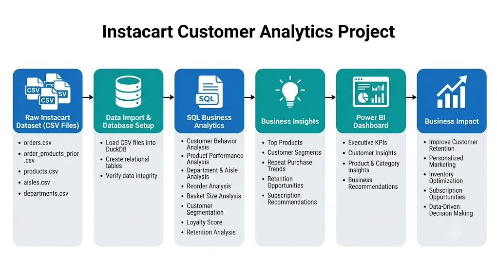

# 🛒 Instacart Customer Behavior & Business Analytics

> An end-to-end Data Analytics project focused on analyzing customer purchasing behavior, shopping patterns, customer retention, and product performance using **Python, DuckDB, SQL, and Power BI**.

---

## 🚧 Project Status

**Current Stage:** Dashboard Development

This project follows a complete end-to-end analytics workflow, transforming raw Instacart transaction data into business insights using DuckDB, SQL analytics, and Power BI.

### Completed

- ✅ Data Understanding
- ✅ DuckDB Database Setup
- ✅ SQL Business Analysis
- ✅ Customer Analytics
- ✅ Dashboard SQL Views
- ✅ Executive Overview Dashboard

### In Progress

- 🚧 Customer & Product Insights Dashboard
- 🚧 Business Report
- 🚧 Documentation & Final Insights

---

# 🏗️ Project Workflow

<p align="center">
  
</p>

---

# 📊 Dashboard Preview

## Executive Overview

The Executive Overview dashboard provides a high-level view of Instacart's business performance, enabling stakeholders to monitor operational KPIs, ordering trends, customer segmentation, and department-level performance.

**Key Highlights**
- 📦 Total Orders
- 👥 Total Customers
- 🛒 Total Products
- 🧺 Average Basket Size
- 🔄 Overall Reorder Rate
- ⏰ Orders by Hour
- 📅 Orders by Day of Week
- 👤 Customer Value Segmentation
- 🏬 Department Performance

<p align="center">
  
</p>

---

## Customer & Product Insights

The Customer & Product Insights dashboard focuses on customer retention, loyalty, and product performance to identify opportunities for improving customer engagement and driving repeat purchases.

**Key Highlights**
- 📈 Top 10 Purchased Products
- 📊 Customer Retention Analysis
- 🔄 Subscription Opportunity Products
- 🏆 Top 10 Loyal Customers

<p align="center">
  
</p>

---


# 🎯 Project Objective

The objective of this project is to analyze customer purchasing behavior and generate actionable business insights that can help Instacart improve customer retention, optimize product recommendations, and identify recurring purchasing patterns.

The project focuses on:

- Customer purchasing behavior
- Product performance
- Customer segmentation
- Customer loyalty
- Customer retention
- Subscription opportunity analysis
- Business KPI reporting
- Interactive dashboard development

---

# 📂 Project Structure

```text
Instacart/
│
├── SQL/
│   ├── business_analysis.sql
│   ├── customer-analytics.sql
│   └── views.sql
│
├── notebook/
│
├── Instacart-Analysis-Workflow.png
├── setup_database.py
├── .gitignore
└── README.md
```

---

# 📊 Dataset

This project uses the **Instacart Online Grocery Shopping Dataset**.

The dataset contains over **3 million grocery transactions** from more than **200,000 customers**, including purchasing history, products, aisles, and departments.

### Dataset Tables

- Orders
- Prior Orders
- Products
- Aisles
- Departments

> **Note**
>
> The raw dataset is not included in this repository because of its large size.

Download the dataset separately and place the CSV files inside a local **data/** folder.

After downloading the dataset, simply run:

```bash
python setup_database.py
```

This script automatically:

- Creates the DuckDB database
- Imports all CSV files
- Creates the required database tables

---

# ⚙️ Database

Instead of using MySQL, this project uses **DuckDB**, an analytical database optimized for fast OLAP queries on large datasets.

The database setup includes:

- Database creation
- CSV import
- Table creation
- Relationship validation
- Dashboard view creation

---

# 🗄️ SQL Analytics

The project contains business-focused SQL analyses designed to answer practical business questions.

## Customer Analytics

- Customer Segmentation
- Customer Loyalty Analysis
- Customer Retention Analysis
- High Value Customer Analysis

## Product Analytics

- Most Purchased Products
- Most Reordered Products
- Product Reorder Rate Analysis
- Subscription Opportunity Analysis

## Business Analytics

- Peak Ordering Hours
- Peak Ordering Days
- Average Basket Size
- Department Performance
- Repeat Purchase Analysis
- Product Affinity Analysis

SQL scripts are available in:

```text
SQL/
├── business_analysis.sql
├── customer-analytics.sql
└── views.sql
```

---

# 📈 Power BI Dashboard (In Progress)

The Power BI dashboard is currently under development.

### Planned KPI Cards

- Total Orders
- Total Customers
- Total Products
- Average Basket Size
- Overall Reorder Rate

### Planned Visualizations

- Orders by Hour
- Orders by Day
- Customer Segmentation
- Department Performance
- Customer Retention
- Customer Loyalty
- Top Purchased Products
- Subscription Opportunity Products

### Planned Filters

- Department
- Order Day
- Order Hour
- Customer Segment

---

# 💡 Business Questions Solved

The project answers business questions including:

- When do customers place the most orders?
- Which products are purchased most frequently?
- Which products have the highest reorder rates?
- Which departments drive repeat purchases?
- Which customers are the most valuable?
- How does customer retention change over time?
- Which products are suitable for subscription services?
- Which customer segments should receive targeted marketing campaigns?

---

# 📊 Current Insights

Current analysis indicates:

- Grocery staples consistently achieve the highest reorder rates.
- Customer purchasing activity varies considerably throughout the day.
- Customer segmentation enables personalized retention strategies.
- Certain departments generate significantly stronger customer loyalty.
- Highly reordered products are strong candidates for subscription services.

Additional insights will be included once dashboard development is completed.

---

# ✅ Progress Tracker

## Phase 1 — Data Understanding

- [x] Dataset Exploration
- [x] Relationship Analysis
- [x] Schema Understanding

## Phase 2 — Database Integration

- [x] DuckDB Setup
- [x] CSV Import
- [x] Database Creation

## Phase 3 — SQL Analytics

- [x] Business Analysis
- [x] Customer Analytics
- [x] Customer Segmentation
- [x] Customer Loyalty
- [x] Customer Retention
- [x] Dashboard SQL Views

## Phase 4 — Dashboard Development

- [ ] Executive Dashboard
- [ ] Product Analytics Dashboard
- [ ] Customer Analytics Dashboard
- [ ] Dashboard Optimization

## Phase 5 — Documentation

- [ ] Business Report
- [ ] Dashboard Insights
- [ ] Final Documentation

---

# 📄 Project Deliverables

The completed project will include:

- DuckDB Database
- SQL Business Analysis
- Customer Analytics
- Dashboard SQL Views
- Interactive Power BI Dashboard
- Business Insights
- Complete Documentation

---

# 🛠️ Tech Stack

## Programming

- Python

## Data Processing

- Pandas
- NumPy

## Database

- DuckDB
- SQL

## Visualization

- Power BI
- Matplotlib

## Development

- Jupyter Notebook
- VS Code
- Git
- GitHub

---

# 🚀 Future Improvements

- Customer Churn Prediction
- Product Recommendation System
- Demand Forecasting
- Customer Lifetime Value Analysis
- Dashboard Deployment

---

## 👨‍💻 Author

**Abdul Samhoon**

Aspiring Data Analyst | Python | SQL | Power BI | DuckDB

Building data-driven business solutions through analytics, visualization, and business intelligence.

---

⭐ **An ongoing end-to-end Data Analytics project demonstrating customer analytics, SQL, DuckDB, and Power BI for business decision-making.**
